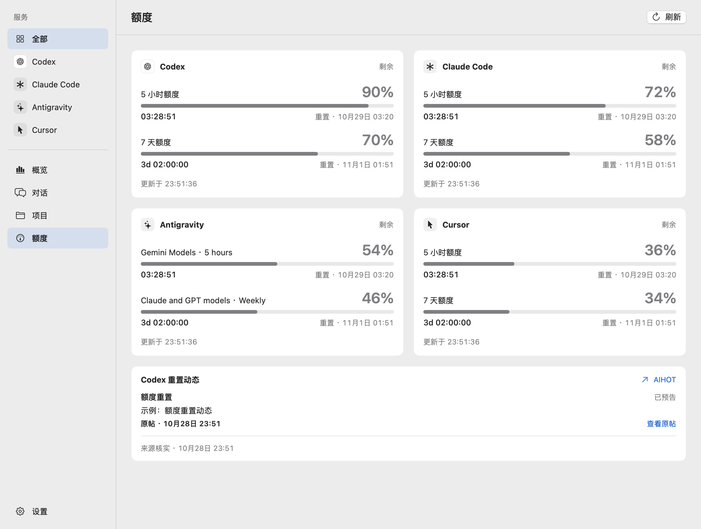
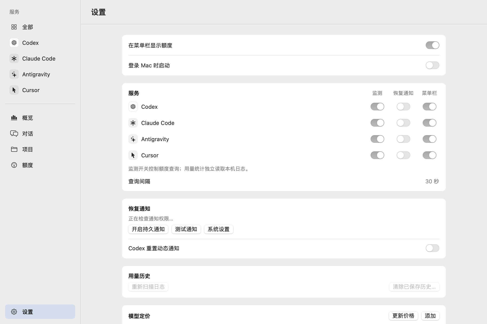

# Codex Quota Dock

在一个 macOS 原生窗口中查看 Codex 的剩余额度、Token 用量和估算费用，额度恢复时收到通知，也可在菜单栏显示剩余百分比。

[下载最新版](https://github.com/sunpm/codex-quota-dock/releases/latest) · [更新记录](https://github.com/sunpm/codex-quota-dock/releases) · [反馈问题](https://github.com/sunpm/codex-quota-dock/issues)



*界面预览由当前源码的原生组件渲染，使用示例数据，不含真实账号或用量。*

## 功能范围

额度通过已登录的 Codex 查询；用量分析读取本机普通及压缩会话日志，支持日期、模型、对话与项目汇总，费用按 API 等价价格估算。

当前源码已收窄为 Codex 专用，移除 Claude Code、Antigravity 和 Cursor 的接入与界面，以减少多服务适配维护。发行版包含的功能以对应更新记录为准。

## 安装

需要 **macOS 13 或更新版本**。

macOS 26 及以上的操作按钮和侧栏采用原生 Liquid Glass；macOS 13–15 使用系统常规样式，功能一致。

1. 从 [Releases](https://github.com/sunpm/codex-quota-dock/releases/latest) 下载安装包：M 系列芯片选 `AppleSilicon.dmg`，Intel 芯片选 `Intel.dmg`。
2. 打开 DMG，将应用拖入 `Applications`，再从“应用程序”启动。
3. 在 Codex 中登录，打开本应用查看额度与用量；按需允许系统通知。

当前安装包使用 ad-hoc 签名，尚未进行 Developer ID 签名与 Apple 公证，macOS 可能阻止首次打开。Release 同时提供 `SHA256SUMS.txt`。

### 首次打开被阻止

如果提示“无法验证开发者”或“Apple 无法检查其是否包含恶意软件”，确认应用来自本仓库的 [Releases](https://github.com/sunpm/codex-quota-dock/releases/latest) 后：

1. 从“应用程序”尝试打开 `Codex Quota Dock`，关闭拦截提示。
2. 打开“系统设置 → 隐私与安全性”，向下滚动，在该应用的拦截信息旁点击“仍要打开”。
3. 按系统提示确认，再点击“打开”。此后可正常双击启动。

如果没有看到“仍要打开”，先再次尝试启动应用，再返回设置查看。详见 [Apple 官方说明](https://support.apple.com/zh-cn/102445)。

## 日常使用

- **查看额度**：在“额度”查看 Codex 剩余百分比与重置倒计时；开启监测时每 30 秒查询，显示更新时间与错误。倒计时在本地计算；失败保留上次读数并标明过期，手动刷新也遵守服务端限流。
- **菜单栏**：用一个开关控制是否显示 Codex 额度；点击打开主窗口，右键可打开主窗口或退出应用。隐藏菜单栏不影响后台监测。
- **恢复提醒**：首次启动允许通知后，可在“设置 → 通知”发送测试通知或开启持久通知引导。macOS 26 及更新版本在系统通知设置中开启桌面提醒并选择“持续”，旧版选择“提醒”。
- **重置动态**：额度页下方独立显示最近三条 Tibo 重置或发卡动态，数据来自 [AIHOT](https://aihot.news/codex-reset)，每 10 分钟查询。可在“设置 → 通知”开启独立的“Codex 重置动态通知”（默认关闭），点击通知打开原帖。
- **后台运行**：关闭窗口后继续监测；有菜单栏额度入口时隐藏 Dock 图标，点击菜单栏可恢复同一窗口和 Dock 图标。未显示菜单栏额度时，关闭窗口仍保留 Dock 入口。`⌘Q` 或菜单栏的“退出 Codex Quota Dock”会彻底退出并停止监测。需要开机启动时，在设置中开启“登录 Mac 时启动”。
- **检查更新**：默认在启动时自动查询 GitHub 最新正式版，后台运行期间约每 24 小时检查一次；发现新版本时，侧栏设置入口显示更新标记。在“设置 → 软件更新”可关闭自动检查（重启后保留选择）、手动检查；仅发现新版本时显示更新说明和对应 Mac 的 Apple Silicon / Intel DMG 下载入口（Rosetta 下也优先下载 Apple Silicon 版）。当前版本的更新说明随发行包保存，每个版本首次打开时弹出一次，离线或关闭自动检查时也可查看；已是最新版时不在设置里重复展示。下载由默认浏览器处理，安装仍需手动完成；没有对应附件时提供发布页入口。检查不使用账号凭据，手动查询也计入自动检查间隔，失败保留上次版本信息；遇到 GitHub 限流等待允许重试的时间，睡眠暂停自动检查、唤醒恢复。

| 快捷键 | 操作 |
| --- | --- |
| `⌘R` | 刷新当前页面 |
| `⌘,` | 打开设置 |
| `⌘W` / `⌘M` | 关闭 / 最小化窗口 |
| `⌘Q` | 退出应用并停止监测 |

<details>
<summary>监测与通知设置预览</summary>



使用示例状态。监测、通知和菜单栏显示可分别控制。

</details>

提醒依据同一 Codex 账号和额度窗口的真实用量从非零恢复到零触发，并跨重启去重。启动时已经满额、显示舍入或倒计时归零不会触发通知；关闭提醒期间仍更新观测基线，不会在重新开启后补发旧事件。若额度在两次轮询之间恢复后又被使用，可能无法观察到恢复。

重置动态属于公开公告，不代表当前账号已恢复，也不会改写额度百分比或个人倒计时。预告超过预计时间仍未获确认时标为“已过预计时间，未确认”；发放重置卡不等于已使用重置卡。原帖日期和来源核实时间按 Mac 本地时区显示，当天的原帖时间使用主文字色并加粗，预告时间保留 AIHOT 返回的时区标注。首次读取仅建立基线，之后新预告与确认分别提醒；超过 24 小时的旧帖只展示。通知去重跨重启保存，关闭动态通知期间仍消费事件；关闭 Codex 监测同时停止动态查询，再开启先重新建立基线。

动态快照、缓存标识、通知去重和下次请求时间保存在本应用 UserDefaults 中，不含账号凭据。手动刷新与重启也遵守 10 分钟间隔及 `Retry-After`；睡眠暂停，唤醒后到期再读取。失败保留上次快照，来源延迟或过期会单独标明，最新成功快照会替换旧列表以应用上游更正或撤回。AIHOT 是独立第三方数据服务，接口与数据使用遵循其[使用条款](https://aihot.news/terms)，不适用本项目或其框架仓库的代码许可。

## 用量统计

### 本机 Codex 用量

- **概览**：总 Tokens 与 API 等价费用为主要指标，对话数和输入缓存命中率紧凑展示，下方是当前范围的趋势、用量构成和高消耗对话。最近 53 周热力图在下方独立展示，不受当前日期范围影响，保留自己的指标切换。
- **时间范围**：今天、昨天、最近 7 / 30 个自然日、全部及自定义日期，按 Mac 本地时区统计。今天和昨天显示小时趋势，较长范围显示每日趋势；顶部 Tokens / 费用切换共同控制趋势指标、排名与表格排序和占比，支持悬停明细。
- **同期比较**：Tokens 与费用对比前一个等长期间，进行中的范围对齐当地截止时刻；“全部”不比较。上期为零显示新增量，费用含未定价记录时不计算涨跌。
- **对话明细**：列表以项目名、所选范围内最近的用量时间和短 ID 识别对话，不读取消息正文；点击名称查看逐条时间、模型、Token 分类、速度档位与费用，并汇总 Standard / Fast / Ultrafast。对话与项目页使用紧凑汇总，为列表保留首屏空间。汇总表使用原生表格，列宽有上下限，长名称、路径和完整对话 ID 可悬停查看。Codex 同一线程的分段日志归为一个对话，独立 fork 仍分开。记录数是已解析的用量事件数，不代表全部网络请求数。
- **项目汇总**：可确认的 Git worktree 与子目录归入主仓库，原始工作目录仍保留在明细中；子模块保持独立，无法确认归属时不按目录名猜测。

本地统计包含现存日志与已采集历史，可能合并本机多个账号，不代表当前账号或其他设备的全部用量。筛选下方显示统计范围、扫描时间与 API 等价费用口径，未定价和读取异常提示位于汇总之前。面板可见时每 30 秒扫描，也可手动刷新；只读取本地文件，不请求服务接口，关闭窗口后暂停轮询。

### 费用与模型定价

本机日志的费用是 **API 等价估算**，以 USD 展示，不代表订阅账单。缺价时显示“未定价”或“部分”，不会算作免费。

内置 [models.dev](https://models.dev) 的 OpenAI 文字模型价格快照，离线可用。在“设置 → 模型定价”可更新公开价格、搜索或添加模型，并调整单价、速度倍率和长上下文阈值。自定义价格优先；空白代表未知，`0` 代表免费。价格变化会重算已采集历史，不保存历史价格版本。

<details>
<summary>日志路径与统计口径</summary>

默认读取 `~/.codex/sessions` 与 `~/.codex/archived_sessions`；启动时传入 `CODEX_HOME` 可指定 Codex 目录。

- Codex 支持 `.jsonl` 和 `.jsonl.zst`，压缩日志按块解码，不生成解压文件；普通与压缩副本、归档迁移和 fork 重放使用同一去重规则。`<线程 ID>_<分段 ID>` 文件名与首条元数据一致时，分段归入原线程，并在扫描时纠正已有历史的对话归属；源日志已删除且无法确认的历史保持原归属。按 `last_token_usage` 统计，累计签名用于去重；缺少该字段的旧事件不从累计值倒推。
- 总 Tokens = 新增输入 + 输出 + 缓存读取 + 缓存写入。缓存命中率 = 缓存读取 ÷ 全部输入（含缓存），分母为零显示不可用。Codex 输入已扣除缓存，输出不重复加上推理 Token。
- 费用使用 `Decimal` 分项计算：各类 Token × 每百万单价 ÷ 1,000,000。长上下文阈值按单条请求全部输入（含缓存）判定，不按整段对话累计量判定。
- 缺少速度的旧日志按 Standard 估算，未知档位保留未定价。缺少缓存保留期时沿用短期缓存估算，不推断缺失的长保留期字段。
- 保留原始模型名，只规范化已知厂商前缀与日期后缀，不猜测未知别名。估算不包含订阅费、税费、折扣或工具调用附加费。

</details>

## 数据与凭据

已采集的本地用量保存在 `~/Library/Application Support/CodexQuotaDock/usage-history.json`。只保存用量、计费与项目归属所需元数据，不保存消息正文或凭据；源日志被清理后，已经采集的记录仍可查看，采集前已删除的内容无法恢复。读取失败保留原文件，保存失败保留内存结果并提示。

“设置 → 用量历史”提供两个操作：**重新扫描日志**会忽略内存文件缓存、保留历史；**清除已保存历史**经确认后仅删除本应用保存的 Codex 历史，再从现存日志采集，不删除源日志、模型定价或其他应用数据。

旧版保存的其他服务历史和自定义价格保留在原存储中，但不再采集、统计或展示；清除 Codex 历史不会清除这些旧记录。

开启额度监测时复用 Codex 已有登录态，不读取浏览器 Cookie，不刷新或改写 Codex 凭据，不保存 token。登录过期后请在 Codex 中重新登录。通知去重仅保存账号标识的 SHA-256 摘要及窗口状态。

<details>
<summary>服务接口与运行边界</summary>

复用 `codex app-server` 的 `account/read` 与 `account/rateLimits/read`；优先使用桌面应用内的 CLI，可用 `CODEX_QUOTA_CLI` 指定路径。

不创建对话、不发起模型任务，也不会自动使用额度重置券。手动更新价格只请求公开价格表，不发送会话信息。

查询失败时退避，延迟依次为 30、60、120、240、300 秒；服务返回冷却时间时遵守其要求。睡眠暂停轮询，唤醒恢复；退出清理应用持有的资源。

Codex 接口或日志格式升级后可能需要适配；没有有效额度时显示不可用，不通过浏览器登录回退。

菜单栏空间不足时 macOS 可能隐藏图标；专注模式与系统通知设置可能影响提醒。30 秒是目标查询间隔，不保证服务端数据同步更新。

</details>

## 从源码构建

需要 Xcode 26 或更新版本（或包含 macOS 26 SDK 的 Command Line Tools）；构建工具要求不改变应用最低 macOS 13 的运行要求。项目采用 Swift Package、SwiftUI / AppKit，无第三方 Swift 包；Zstandard 解码源码静态编译，无需额外安装 `zstd`。

```sh
git clone https://github.com/sunpm/codex-quota-dock.git
cd codex-quota-dock
bash scripts/build.sh
open "dist/Codex Quota Dock.app"
```

应用产物位于 `dist/`。现有离线检查入口：

```sh
bash scripts/test.sh
```

检查覆盖 Codex 解析、通知去重、限流、设置及窗口生命周期，使用模拟客户端，不读取真实凭据或调用服务接口。窗口检查不显示 Dock 图标或激活应用。编译与离线检查通过不等于真实账号已连接。

<details>
<summary>打包、发布与诊断</summary>

按架构生成 DMG：

```sh
bash scripts/package-dmg.sh arm64
bash scripts/package-dmg.sh x86_64
```

脚本复用标准构建，使用系统 `hdiutil` 生成并校验镜像，产物位于 `dist/`。构建固定使用 native 引擎，避开 Swift Build 将 SDK 版本误写为最低系统版本、使系统沿用旧外观的问题。可通过 `APP_VERSION` 指定版本；本地默认使用源码版本与当前架构。`RELEASE_NOTES_FILE` 可指定要嵌入安装包的 UTF-8 Markdown 更新说明；未提供时，本地构建不弹出首次更新说明。

推送 `vX.Y.Z` 标签会触发 [Release 工作流](.github/workflows/release.yml)，在 `macos-15-intel` / Xcode 26.3 上运行检查、分别构建 Apple Silicon / Intel DMG，并发布校验值。`-beta.1`、`-rc.1` 等后缀标记为预发布，不设为 Latest。标签完整版本写入产物的 `ReleaseVersion`，让更新检查区分同版本号的预发布与正式版；标签版本与运行编号只写入构建产物，不回写源码元数据。

更新说明在构建前由 GitHub 原生 Release Notes 根据已合并 PR 生成，同一份说明嵌入两个架构的安装包并用于发布页，发布页另附安装提示。已有正式版本时从最近成功发布的正式版本累计，包含发布失败标签中的改动，配置见 [.github/release.yml](.github/release.yml)。发布使用 Actions 自带 `GITHUB_TOKEN` 和 `contents: write` 权限，无需额外 PAT。已发布版本使用新标签更新，不覆盖原附件；上传失败留下的未发布草稿需确认并清理后重跑。

构建后的应用提供两个可选诊断入口：

```sh
"dist/Codex Quota Dock.app/Contents/MacOS/CodexQuotaDock" --probe
"dist/Codex Quota Dock.app/Contents/MacOS/CodexQuotaDock" --render-menu-previews work/menu-previews
```

`--probe` 会使用真实 Codex 登录态查询，仅输出登录复用状态及剩余百分比；`--render-menu-previews` 使用示例数据生成菜单栏图片，不启动监测。

</details>

## 致谢

界面、日志解析和服务接入参考了 [cc-bar](https://github.com/nanvon/cc-bar)、[cc-switch](https://github.com/farion1231/cc-switch) 与 [CodexBar](https://github.com/steipete/CodexBar)；模型价格来自 [models.dev](https://models.dev)，压缩解码使用 [Zstandard](https://github.com/facebook/zstd)。来源、改编范围和许可见 [THIRD_PARTY_NOTICES.md](THIRD_PARTY_NOTICES.md)，完整声明随应用分发。
